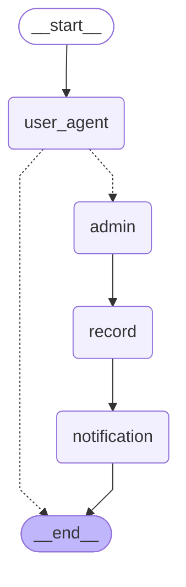
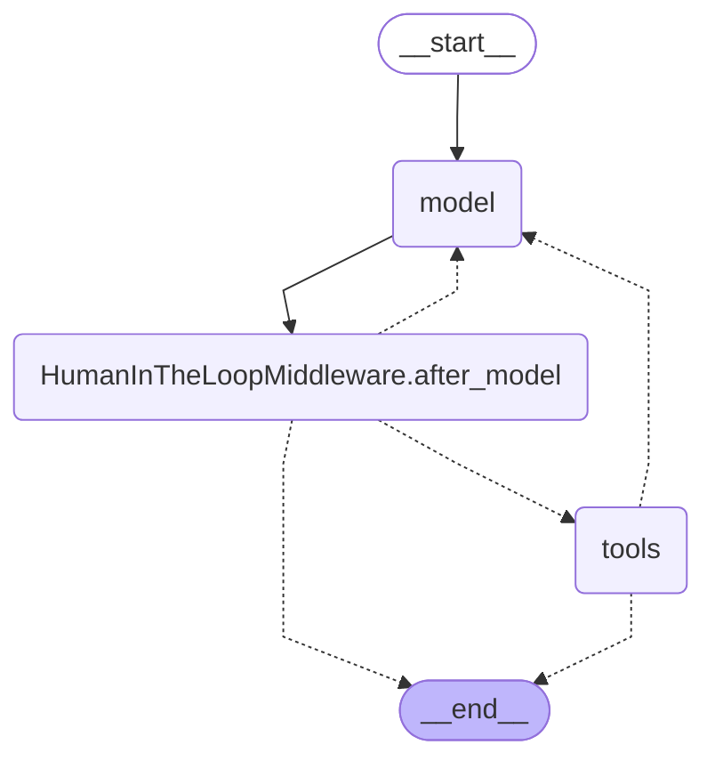

# LangGraph diagrams

Generated by `uv run python -m scripts.export_graph` from the code - regenerate after
changing a graph. Solid arrows are fixed edges; dotted arrows are conditional (decided
at run time).

- **ParkingGraph** - one conversation: `user_agent` handles the customer's turn and, after
  `confirm`, routes to `admin` (the human-in-the-loop pause), then `record` (MCP / status)
  and `notification` (the customer's pop-up).
- **User agent** - runs inside `user_agent`; its middleware (PII redaction, history
  summarization, ending the turn after a review) shows up as extra steps.
- **Admin agent** - runs inside `admin`; `HumanInTheLoopMiddleware.after_model` is where
  it pauses for the administrator's decision.

## ParkingGraph (app/ai/graph.py)



## User agent (app/ai/agents.py)

```mermaid
---
config:
  flowchart:
    curve: linear
---
graph TD;
	__start__([<p>__start__</p>]):::first
	model(model)
	tools(tools)
	end_after_review\2ebefore_model(end_after_review.before_model)
	PIIMiddleware\5bemail\5d\2ebefore_model(PIIMiddleware[email].before_model)
	PIIMiddleware\5bemail\5d\2eafter_model(PIIMiddleware[email].after_model)
	PIIMiddleware\5bcredit_card\5d\2ebefore_model(PIIMiddleware[credit_card].before_model)
	PIIMiddleware\5bcredit_card\5d\2eafter_model(PIIMiddleware[credit_card].after_model)
	PIIMiddleware\5bphone\5d\2ebefore_model(PIIMiddleware[phone].before_model)
	PIIMiddleware\5bphone\5d\2eafter_model(PIIMiddleware[phone].after_model)
	PIIMiddleware\5bname\5d\2ebefore_model(PIIMiddleware[name].before_model)
	PIIMiddleware\5bname\5d\2eafter_model(PIIMiddleware[name].after_model)
	PIIMiddleware\5bsurname\5d\2ebefore_model(PIIMiddleware[surname].before_model)
	PIIMiddleware\5bsurname\5d\2eafter_model(PIIMiddleware[surname].after_model)
	PIIMiddleware\5bcar_number\5d\2ebefore_model(PIIMiddleware[car_number].before_model)
	PIIMiddleware\5bcar_number\5d\2eafter_model(PIIMiddleware[car_number].after_model)
	SummarizationMiddleware\2ebefore_model(SummarizationMiddleware.before_model)
	__end__([<p>__end__</p>]):::last
	PIIMiddleware\5bcar_number\5d\2eafter_model --> PIIMiddleware\5bsurname\5d\2eafter_model;
	PIIMiddleware\5bcar_number\5d\2ebefore_model -.-> SummarizationMiddleware\2ebefore_model;
	PIIMiddleware\5bcar_number\5d\2ebefore_model -.-> __end__;
	PIIMiddleware\5bcredit_card\5d\2eafter_model --> PIIMiddleware\5bemail\5d\2eafter_model;
	PIIMiddleware\5bcredit_card\5d\2ebefore_model -.-> PIIMiddleware\5bphone\5d\2ebefore_model;
	PIIMiddleware\5bcredit_card\5d\2ebefore_model -.-> __end__;
	PIIMiddleware\5bemail\5d\2eafter_model -.-> __end__;
	PIIMiddleware\5bemail\5d\2eafter_model -.-> end_after_review\2ebefore_model;
	PIIMiddleware\5bemail\5d\2eafter_model -.-> tools;
	PIIMiddleware\5bemail\5d\2ebefore_model -.-> PIIMiddleware\5bcredit_card\5d\2ebefore_model;
	PIIMiddleware\5bemail\5d\2ebefore_model -.-> __end__;
	PIIMiddleware\5bname\5d\2eafter_model --> PIIMiddleware\5bphone\5d\2eafter_model;
	PIIMiddleware\5bname\5d\2ebefore_model -.-> PIIMiddleware\5bsurname\5d\2ebefore_model;
	PIIMiddleware\5bname\5d\2ebefore_model -.-> __end__;
	PIIMiddleware\5bphone\5d\2eafter_model --> PIIMiddleware\5bcredit_card\5d\2eafter_model;
	PIIMiddleware\5bphone\5d\2ebefore_model -.-> PIIMiddleware\5bname\5d\2ebefore_model;
	PIIMiddleware\5bphone\5d\2ebefore_model -.-> __end__;
	PIIMiddleware\5bsurname\5d\2eafter_model --> PIIMiddleware\5bname\5d\2eafter_model;
	PIIMiddleware\5bsurname\5d\2ebefore_model -.-> PIIMiddleware\5bcar_number\5d\2ebefore_model;
	PIIMiddleware\5bsurname\5d\2ebefore_model -.-> __end__;
	SummarizationMiddleware\2ebefore_model --> model;
	__start__ --> end_after_review\2ebefore_model;
	end_after_review\2ebefore_model -.-> PIIMiddleware\5bemail\5d\2ebefore_model;
	end_after_review\2ebefore_model -.-> __end__;
	model --> PIIMiddleware\5bcar_number\5d\2eafter_model;
	tools -.-> end_after_review\2ebefore_model;
	classDef default fill:#f2f0ff,line-height:1.2
	classDef first fill-opacity:0
	classDef last fill:#bfb6fc
```

## Admin agent (app/ai/agents.py)


